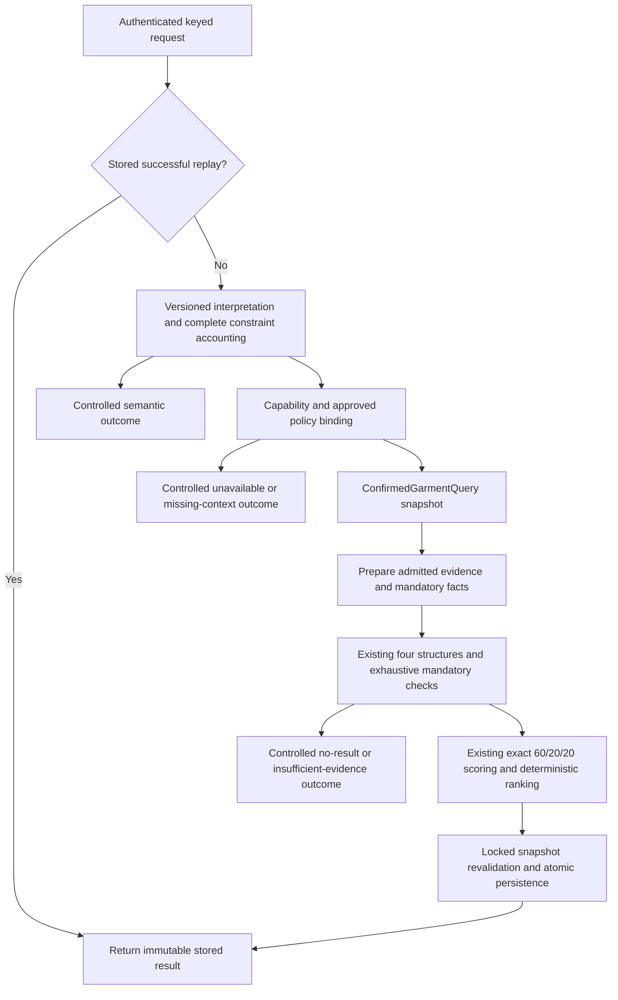

# Generalised context-aware recommendation architecture review

2026-10-24, Asia/Kuala_Lumpur. **Review complete; framework proposed for approval.**
The wedding extension is provisionally owner-accepted PASS WITH LIMITATIONS.
This review adds no situation support, changes no production code or policies,
and gives no implementation or deployment approval. Existing requirement counts
remain **144 Verified / 2 Partial / 9 Unverified / 0 Blocked, 155 total**.
RN-13 remains Partial; NFR-02 remains OPEN / NOT FORMALLY ACCEPTED.

**Recommendation:** retain the wedding profile as a compatibility baseline and
build one versioned context model, interpretation grammar, capability registry,
evidence resolver and constraint compiler. New situations should be registry
entries and approved bindings to reusable predicates, not separate interpreters,
evaluators or scorers. Understanding an event must not automatically authorise
an outfit policy for it.

## 1. Review method and preservation finding

Inspected the actual working-tree interpreter, context/evidence value objects,
review writer/projection, suitability evaluator/configuration, profile selection,
compact/public mandatory checks, scoring preparation, persistence, startup and
frontend messages/explanations. Also inspected the original NLP/declared-policy
boundaries, attribute adapter and retained wedding tests/results.

Read-only hashing found **all346 indexed wedding deliverables match** their
retained hashes. **27 protected source/configuration paths** match their
pre-wedding bytes, including the original NLP/vocabulary, request/preference
scoring, compact numerical facts/enumeration, structure and compatibility-decision
policies, original declaration evaluator/parser, Homepage engine, persistence
writer, ConfirmedGarmentQuery interface and durable authentication/revocation.
Current wedding source matches the state associated with the retained703 backend
and10 Chrome passes. Those executions were inspected, **not rerun here**.

Twelve pure interpreter/capability probes retrieved no garments and generated
no outfits. Of the nine requested examples, the wedding example is syntactically
Supported and its request policy is available. The other eight return
UnsupportedRequest/unsupported_intent through the legacy path. Wedding plus
"tomorrow" returns unrecognized_condition; recognised groom/formal requests have
no supported wedding policy. These are parser observations, not new API/browser
or recommendation-validity tests.

New review artifacts are in
`storage/verification/context_architecture_review_20261024/`: starting hashes,
the346-file comparison, protected-boundary hashes, parser observations and final
integrity/index. No server, regression suite, benchmark, model or database was
run/opened. No existing evidence or service configuration was changed.

### Current safeguards actually preserved

| Boundary | Inspected implementation / conclusion |
|---|---|
|Previous Assistant|Non-wedding interpretation/evaluation delegates to v1. The disabled profile retains original startup selection. The opt-in wedding profile deliberately adds wedding support; it does not make all natural situation statements supported. Delegated provenance records the effective legacy evaluator and the contextual adapter separately.|
|Scoring|Exact weights remain3/5,1/5,1/5. Numerical request/compatibility/preference preparation is unchanged. Context gates run before scoring; no new bonus, confidence score or renormalisation was added.|
|Structures and enumeration|Exactly upper+lower, upper+lower+outerwear, one-piece, one-piece+outerwear; existing order/count/completion checks remain.|
|Garment acquisition|The adapter still joins the owner's available garment to a confirmed processing item and owner-matching processing job. Retrieval still validates identity/media/owner/status/category/role/layer. The wedding change adds immutable evidence projection, not different eligibility SQL.|
|Independent checks|Primary and separately prepared verifier facts plus public reconstruction/gate must agree. They share the production member resolver; this is independent preparation/reduction, not two independently designed fashion engines. The new tests additionally contain a separate labelled truth-table oracle.|
|History and replay|The repository checks complete current snapshots under its write lock. Existing JSON provenance storage captures new evidence without a schema migration. Successful keyed replay occurs before interpretation/ranking; old results are not reinterpreted.|
|Quota/auth/other modules|The writer's100 non-archived-entry quota remains. Durable auth code is unchanged; the review endpoint uses its authoritative dependency. Homepage random/no-chat behaviour, CV/VTON and existing declarations remain separate.|

This is source/evidence continuity within the accepted tested scope, not fresh
certification of every browser, model, deployment or future policy.

## 2. Reusable mechanisms and wedding-specific coupling

| Component | Reusable foundation | Current wedding-specific limitation |
|---|---|---|
|`contextual_nlp_interpreter.py`|Original-text preservation, controlled extraction, explicit unknown/conflict rejection, legacy delegation, version/hash.|Dispatch requires the word wedding; event/role/code regexes and one added occasion are embedded in Python. No activity/venue/time/comfort frame. Consumed role/code spans are not retained as ordinary extraction matches.|
|`contextual_outfit_request.py`|Frozen request extension, explicit versus assumed role, unchanged base request serialization.|Requires WeddingContext, occasion=wedding and formality=dress_code. This cannot represent dress code and formality independently.|
|`contextual_garment_evidence.py`|Immutable projection; missing/malformed states; retained identifiable Deny; value/category-bound review.|Only singleton style review plus wedding_decisions. It is not a general field-provenance or calibrated AI-confidence contract.|
|`contextual_review.py` and wardrobe writer|Authenticated explicit review, content revision, transactional writes, stale-review invalidation, namespace protection.|Review/control/projection is style-and-wedding specific. Generic confirmations are correctly not treated as reviews of every attribute.|
|`contextual_suitability_evaluator.py`|Deny precedence, distinct declaration/inference basis, all-member Fail/Unknown aggregation and provenance.|Expected styles and W01-W03 branching are in Python as well as JSON. Rule JSON is validated metadata, not a generic executable rule model. The loader checks version/default/rules, not every metadata field or cross-reference.|
|Mandatory integration|Precomputed member tables, exhaustive generation, approved-type gates, public reconstruction.|Only existing fields and approved concrete evaluator types are understood. New roles/venue/activity cannot safely be added just to the interpreter.|
|`contextual_selection.py`|Explicit opt-in and failure on invalid/incomplete profile selection.|One contextual profile and default-constructed evaluator. `CompactAssistantScorer` obtains only the evaluator's type, discarding constructor configuration; this is a constraint for multiple versioned policy bundles.|
|Service/UI|Stored assumptions, rule/hash/member basis, safe controlled messages and preserved long-name wrapping.|Service/provenance and UI use contextual_wedding, WeddingExplanation and three wedding-specific message strings. Capabilities currently expose only Homepage/Assistant booleans.|

Do not copy these wedding classes for interviews, dates or hiking. Also do not
describe this review as a discovered scoring/eligibility regression: the findings
are limits of generality and configuration design. No inspected finding justifies
another ranking algorithm, capacity reduction or speculative optimisation.

## 3. Proposed situation taxonomy

The following is a **draft interpretation taxonomy**, not approved suitability
policy. Families organise vocabulary; they do not confer inherited suitability.
Stable semantic IDs must be independent of human labels and policy versions.

| Desired input | Proposed situation / activity | Context actually expressed | Unknowns and admission boundary |
|---|---|---|---|
|I'm going to a wedding.|ceremony.wedding / attending|Wedding; no role or dress code.|Only the already approved wedding profile has a guest convention/W01-W05. Preserve it exactly.|
|I have a job interview tomorrow.|professional.job_interview / interview participation|Job interview; temporal literal tomorrow.|Candidate/interviewer role, venue and code are not guaranteed. Do not equate interview with formal. New binding/conventions require approval.|
|I'm going on a date tonight.|social.date / socialising|Date; temporal literal tonight.|No restaurant, gender, formality or weather inferred. Exact date declaration mapping is possible; new fallback policy remains unapproved.|
|I'm going to the beach.|leisure.beach_visit / unspecified|Beach venue.|Swimming, walking, conditions and required equipment are not established. Do not silently choose an activity.|
|I have a university presentation.|academic.presentation / presentation-related|University setting and presentation.|Presenter versus attendee is not explicit as it would be in "I'm presenting". No automatic campus/work formality inheritance.|
|I'm attending a graduation.|ceremony.graduation / attending|Graduation; attending.|Graduate, guest and ceremony requirements remain unspecified. Wedding conventions do not transfer.|
|I'm going hiking.|outdoor.hiking / hiking|Activity explicitly named.|No terrain/conditions/equipment proof. Recognise the intent, but keep capability unavailable for a complete specialised outfit in the current contract.|
|I'm meeting friends for dinner.|social.meal / dining|Dinner and companions=friends.|Do not assume a restaurant or dress code. Exact dinner declaration mapping is possible; no new policy approved.|
|I want something comfortable for travelling.|travel.journey / travelling|Travel and a comfort goal.|Transport, conditions and garment comfort evidence are not established. Recognising comfort is not proving it.|

Use one primary situation and one primary activity initially; compound schedules,
alternatives and competing events remain controlled unsupported/ambiguous outcomes.
Additional explicitly stated facets may be represented without creating another
chat turn. Do not infer hiking is casual, beach means swimming, travel means
flying, or ceremony means formal.

### Common context model

Each slot should carry a typed value, semantic state and source spans. Keep:

- Situation/event; activity; user role; venue type; explicitly stated environment.
- Dress code and requested formality as **separate** slots. Black tie, for
  example, is not silently rewritten to a currently supported casual code.
- Explicit required style/colour/category constraints, using current semantics.
- Preference-strength language and goals such as comfort, separately from hard
  requirements and from the user's saved preferences.
- Temporal literals such as tomorrow/tonight; approved assumptions; unrepresented
  conditions; interpretation/schema version. Companions may be a small explicit
  facet so "friends" is accounted for without inventing a user role.

Distinguish **Unspecified** (not provided), **Known**, **Ambiguous**, **Conflicting**
and **Unsupported**. These are semantic states, not numeric confidence scores.
An absent optional slot need not block a rule that does not depend on it. A
missing required slot, or an explicit meaningful condition the system cannot
handle, must block selection. Unknown is never an implicit Allow.

For "I have a job interview tomorrow", store the interview and temporal spans;
leave role/venue/code/formality unspecified and assumptions empty unless a
separately approved binding supplies a disclosed convention. Do not fabricate
style=classic, formality=formal or venue=office.

## 4. Generalised contextual NLP and orchestration

Recommend a compositional grammar and lexicon first: shared frames such as
"I'm going to EVENT", "I have EVENT", "I'm attending EVENT", "I'm meeting
COMPANIONS for MEAL" and "I want GOAL for ACTIVITY". Situation vocabulary,
role phrases, code clauses and venue phrases are data, not one interpreter per
event. Canonicalisation must be span-based and deterministic; grammatical role
derivation from "I'm presenting" is distinct from assuming a role because of
an event noun. Preserve each meaningful modifier and its interpretation.

Resolve overlaps explicitly: style versus formality, date as event versus time,
university as venue versus the legacy campus occasion. A keyword match alone
is insufficient. Unknown modifiers, negation, conditional requests, multiple
events and conflicting constraints must not be stripped to make a request pass.
Do not expand a glue-word list until unsupported requirements disappear.

Interpretation produces an immutable frame without wardrobe queries or clothing
judgements. A separate binder consults the active capability/policy registry.
It selects only approved bindings, records required predicates and assumptions,
and builds a versioned request compatible with the current request interface.
Recognised but unavailable contexts retain their explanation; they do not fall
back to "Suggest an outfit" with all context removed. Server construction remains
authoritative; the client must not submit trusted eligibility facts or policy code.

Tomorrow/tonight require an explicit product contract: initially record them as
timing information, disclose that the current wardrobe is used, and make no
forecast, scheduling, future-availability or night-formality claim. Weather,
delivery or other additional requirements cannot be discarded under that rule.
Accepting this treatment is an approval decision, not implemented behaviour.

Broader paraphrases eventually need a separately labelled corpus. A future
statistical/LLM extraction adapter could target this same validated frame, but
is not required for the first framework and gets no authority to invent context
or suitability. No model/provider, cloud transfer or download is selected here.

### Stable outcomes and user experience

Prefer versioned reason codes/context summaries with the existing top-level
outcomes rather than silently expanding RankingOutcome/HTTP semantics:

| Situation | Outcome / proposed reason | User-facing action |
|---|---|---|
|Unrepresentable or conflicting meaning|UnsupportedRequest / ambiguous_context or unsupported_constraint|Identify the condition and ask for an edited request in a new chat.|
|Required context missing and no approved convention|PolicyUnavailable / required_context_missing|State the role/code/activity needed to select a supported policy.|
|Known event/code/activity not enabled or outside capability|PolicyUnavailable / capability_not_enabled or unsupported_dress_code|Explain what is understood and why no appropriate result can be established.|
|Admitted policy but required garment evidence missing|InsufficientEvidence / required_attribute_unknown|Identify reusable fields to review, not a grid of occasion tags.|
|Mandatory conditions fail|NoMatchingCandidates / requirement_failed|Explain the relevant choice/constraint without relaxing it.|
|All gates pass|Selected|Show exactly one result and a stored explicit-versus-inferred explanation.|

No follow-up chat, auto-resubmission, changed completed request or silent policy
relaxation is proposed. A future optional draft preview/confirmation is a separate
UI decision and must remain before the single submission. The minimal framework
uses the existing input and result/error workflow. Extend capabilities with a
versioned, authenticated context-support block while retaining the two current
booleans; display human-readable supported situations/limits, not configuration
secrets or raw internal rule identifiers.

## 5. Suitability inference architecture

Separate five responsibilities:

1. **Taxonomy/lexicon:** what was expressed; no fashion or safety approval.
2. **Capability and binding registry:** which event/activity/role/code combinations
   are implemented, approved and enabled; required evidence; declaration scope;
   allowed assumptions; versions/hashes. Membership of a taxonomy family alone
   does not activate a policy.
3. **Evidence resolver:** canonical observed values, source/admissibility, staleness,
   declaration decisions and malformed/conflicting evidence, without scoring.
4. **Constraint compiler/evaluator:** a small allowlisted predicate/combinator
   language, compiled once per request and reduced to mandatory Pass/Fail/Unknown.
5. **Existing scorer/persistence:** unchanged numerical functions, weights, ties,
   complete enumeration and immutable storage/replay.

Reusable primitives may include known canonical equality/set membership,
admitted-source checks, current value-bound review, exact declaration lookup,
and all-required predicates. No Python expressions, dynamic imports, arbitrary
class names or executable code belong in policy JSON. Validate the entire schema,
field/operator types, references, units, bundle compatibility, dependency graph,
bounded rule counts and activation state at startup. Unknown operators or partial
configuration fail closed. Shared primitives are reusable code; their use for
a new event still needs an approved applicability binding.

Example of intended reuse: one reviewed-style predicate can support several
explicitly approved social/academic appearance bindings. This does **not** mean
the existing wedding smart-casual convention is automatically approved for an
interview, graduation or date. Each binding must state its context limits and
assumptions. Adding a situation should need lexicon/taxonomy/binding entries and
tests, not a new service, scorer or event-specific evaluator class.

### Admission and decision order

First verify that the complete requested capability, code and required evidence
types are supported. An owner Allow cannot manufacture a missing safety or
specialised-clothing capability. Then, for every applicable condition/member:

1. Identifiable valid explicit Deny is Fail, including a coexisting Allow.
2. Otherwise malformed/conflicting authoritative declarations block inference.
3. A clean applicable explicit Allow supplies positive evidence for that exact
   condition only; retain its source as `explicit_declaration`.
4. Only genuinely absent declarations may use approved attribute predicates.
   Record their source as `attribute_inference`, required observations and rule.
5. Missing, stale, inadmissible or ambiguous required attributes yield Unknown.
   Known contradictory evidence may yield Fail only under an approved predicate.

Aggregate Fail before Unknown; require every mandatory condition and every member
to pass, including outerwear. Policy-declared dependencies determine which fields
are required; do not require every context slot to be filled for every rule.
Keep full atomic reasons/proofs even if the hot loop uses a combined context gate.
Role-specific atomic checks must not leave another member implicitly accepted.
Initial generic support should stay within per-member predicates; new global
outfit requirements or pairwise hard rules require their own scope approval.

Do not replace current compatibility handling, convert its scored colour/style
atoms into new hard fashion rules, or use its missing-atom midpoint to turn
Unknown contextual suitability into Pass. The existing compatibility conventions
are ranking conventions, not evidence of suitability for a new activity.

### Scoring projection and preference semantics

Retain the original five-field projection for request scoring. An approved
primary situation may occupy one occasion condition; extra activity/role/venue
requirements are mandatory context gates and provenance, not extra R terms.
Do not add one score contribution for every inferred facet or synthesize a style
to raise request match. The same candidates with the same five explicit fields,
preferences and compatibility facts must retain the same exact scores and ties.

Saved preferences still enter only through the existing normalizer/P snapshot.
They never establish a garment's actual attributes. "Prefer blue" must not be
silently promoted to a hard blue requirement or persisted as a profile change.
Recognise such soft language separately; new request-time soft-ranking semantics
remain unavailable until expressly approved. Comfort likewise needs an approved
meaning/evidence rule; it is not automatically converted into loose fit or cotton.
This avoids changing preference handling under an NLP expansion.

## 6. Evidence, confidence and minimal manual confirmation

**Current evidence is sufficient for narrow appearance heuristics, not for all
the desired situations.** The trusted reusable addition is one reviewed canonical
style/category binding. Category chiefly establishes structure; colour supports
existing colour rules. Fit/material are descriptive values without the new
field-review contract. No reviewed functional comfort, weather protection,
activity rating, footwear/equipment completeness or generic dress-code evidence
contract exists in the snapshot.

The attribute adapter can retain model/version data and raw head confidence for
some visual attributes, but that does not establish calibrated contextual
reliability and is not a per-field admissibility contract in the current query.
Detector confidence is not style/material confidence; an embedding is not a
proof of suitability. `color_temperature=warm` describes hue, not insulation.
Garment category or colour must not establish comfort or activity safety.
Existing model-evidence handoffs remain separate and unaccepted where evidence
is missing; this review neither runs models nor disproves teammate execution.

Propose two admission channels with distinct provenance:

| Evidence | Admissible use |
|---|---|
|Current owner-reviewed exact field values|Approved descriptive predicates, with the stated subjective/observational scope. No independent fashion/safety certification implied.|
|Model-derived field with independently accepted provenance/calibration contract|Only approved fields/domains/operating conditions after raw evidence and field-specific quality/threshold review; no arbitrary global0.8/0.9 cutoff chosen here.|
|Unreviewed/unvalidated/low-confidence model suggestion|Display as suggestion for correction; Unknown for required inference. A high raw probability alone does not admit it.|
|Missing/stale/malformed/conflicting value|Unknown; never an averaged score, fabricated default or automatic Allow.|
|Explicit owner suitability declaration|Separate authoritative scoped decision, not a prediction confidence. It cannot enable unsupported capabilities.|

Keep interpretation certainty, attribute trust and policy applicability separate.
Do not multiply them into a single fashionable-looking confidence number or
average away a Deny. Known false/zero differs from absent evidence. A subjective
owner comfort assessment, if approved later, can express that owner's experience;
it does not establish universal material performance or safety.

### Proposed confirmation strategy

- Preserve valid v1 style reviews and their staleness rules. Read them through
  an adapter into the general evidence interface; do not ask users to review
  the same unchanged style again for each situation.
- In the ordinary upload/edit review, let users explicitly confirm the few
  visible attributes needed for enabled rules, with images/current values shown.
  Generic "confirm garment" must not attest every AI-produced field.
- Request correction/review only for missing or uncertain required attributes.
  Do not add mandatory wedding/interview/date/presentation suitability grids.
  Keep occasion overrides as optional exceptions.
- If richer fields are approved, add a separate versioned field-evidence JSON
  namespace and immutable projection. Initially keep style in the existing v1
  source of truth; adapt it rather than duplicate it in a competing v2 store.
  New fields carry canonical values, exact value/dependency binding, source,
  reviewer/time or model/version evidence, schema and admissibility state.
- Invalidate changed fields and their declared dependencies, not every unrelated
  review. No historical inferred backfill or automatic owner-review promotion.
  Preserve reserved-metadata protections, mirror conflict handling, ownership,
  optimistic revisions and transaction rollback.
- Optional batch review requires images/values and explicit selected items, with
  per-item revision validation. It is a later UX/storage approval, not an excuse
  to mark all existing records reviewed or to change the quota.

No SQL migration is inherently required for a first additional JSON evidence
projection. That is a proposed storage approach, not approval to write a private
DB or acceptance of SQLite as the final architecture. Real automatic attribute
admission requires shared CV evidence/contracts and separate permission.

## 7. Existing declarations, wedding compatibility and RN-13

The current declared policy has eight enabled occasions and casual/smart_casual
formality; exercise/formal remain unavailable. Keep its files, tags, data and
legacy behaviour unchanged. Its Allow+Deny conflict produces Unknown, which
already blocks selection. The wedding profile explicitly adds Deny-wins semantics
for its contextual evaluation. Do not rewrite that original state function merely
to generalise the new resolver.

Use an explicit, approved semantic crosswalk for declaration applicability:

| New context relationship | Required treatment |
|---|---|
|Date, dinner or travel with the same exact meaning as v1|Bind to the same existing declaration target; applicable Deny cannot be escaped by a new alias or policy ID.|
|Wedding|Retain the approved wedding namespace and W01-W05 semantics; no inherited party/dinner Allow.|
|Job interview versus work|Related does not mean identical. Approve the scope mapping before activation; do not silently inherit a positive work declaration or ignore a possibly applicable Deny.|
|University presentation versus campus|Venue and occasion are distinct. No automatic promotion of campus Allow to presentation suitability. Resolve applicability explicitly.|
|Hiking versus exercise|Recognition does not close unavailable exercise/specialised evidence or authorise an Allow.|

Where the scope of an existing declaration is ambiguous, block the new binding
until resolved; do not choose a narrower new label to bypass it. Any approved
broad negative scope must be explicit; positive parent evidence cannot supply
additional child requirements. Declaration aliases and scope mappings belong
in versioned, tested registry data, not string-similarity guesses.

### Explicit compatibility contract is necessary

Preserve `disabled`/legacy and `wedding_guest_v1` profiles. Propose a separate
opt-in general profile with immutable bundle versions/hashes. Its eventual
approved inference may broaden outcomes for **absent** declarations compared
with the strict legacy profile. That is an intentional new contract requiring
approval, not byte-equivalent old behaviour or silently treating malformed
Unknown as absent. Within a general profile, semantically equivalent natural
and command-style requests should resolve to the same binding and declaration
scope; avoid a hidden wording-dependent legacy-first escape hatch.

The frozen wedding profile remains the correctness baseline. Port W01-W05 to
the generic representation only with independent differential checks for
all states, explicit constraints, roles/codes, every structure, selected scores
and history. Keep the original profile, JSON and retained results available;
do not copy this one compatibility boundary into a separate pipeline for every
new situation. Do not activate the general profile automatically.

RN-13's original sentence is: "The recommendation component shall filter
candidate garments according to the structured conditions extracted from the
submitted request." The future framework strengthens enforcement only when it
accounts for all represented requirements and has approved evidence/rules. Adding
event words alone does not fulfil it. Roles, activities, venues and goals expand
the bounded interpretation scope/CA-10 and need owner/supervisor scope decisions.
Exercise/formal/general colour limitations do not disappear through a taxonomy.

RN-17 arithmetic, RN-28 output validity and immutable histories remain unchanged
obligations. RN-27's original fixed dataset/80% criterion and raw results stay
intact; the703 checks are not a new NLP accuracy rate. New contextual labels and
validity audits must be separate. Counts remain144/2/9; no original requirement
or formal NFR acceptance advances in this review.

## 8. Performance and regression risks at100 garments

Current normal compact execution already prepares occasion/formality states
outside candidate enumeration. For N garments and K requested suitability
conditions, the primary and independently prepared tables make about2*N*K
member-resolution calls. With N=100 and K<=2 this is at most400 during preparation.
Winner reconstruction/gate/explanation add bounded calls for at most3 members.
Audit mode can reconstruct every candidate; that is distinct from the ordinary
non-audit execution path. These are static call-path counts, not measured timings.

The hot loop reduces prepared tables; it does not invoke contextual NLP or the
member inference resolver anew for each candidate. The unchanged structural count
is `(upper*lower + one_piece)*(1+outerwear)`; retained100-entry evidence includes
38,148 candidates at the frozen maximum combination. No new capacity proof was
run. The quota counts stored non-archived entries, not exactly100 eligible
snapshots; old unusual/over-limit accounts remain a separate data-readiness issue.

Risks to watch, without speculative optimisation:

- Multiple fresh evaluator constructions load policy/vocabulary files, including
  the type probe, two preparations, public gate and explanation. Future bundle
  injection must preserve independent facts while avoiding accidental dependence
  on mutable global configuration; no cache change is implemented here.
- A generic implementation must compile only the active request's approved
  predicates, not iterate every situation/rule for each candidate.
- Prepare admitted per-field/atomic facts in O(N*K), with bounded storage.
  A combined per-member context gate may keep hot-loop work bounded while
  retaining complete atomic proof/reasons for independent checking and explanation.
  Never cache eligibility globally across owners, requests, snapshots or versions.
- No database calls, image inference, remote model calls, NLP parsing or config
  reads inside candidate evaluation. Full explanation serialization belongs to
  the selected result, not all candidates in ordinary operation.
- Additional JSON evidence increases projection/revalidation/provenance work;
  capability discovery/preview could add requests. Review these changed paths
  instead of claiming unchanged timings solely from identical weights.

No current measurement establishes a new latency defect or a need to optimise.
Future verification should first use semantic/call-count assertions, then only
a justified changed-path timing delta on retained inputs if required. Reuse
unchanged numerical/capacity evidence; do not repeat J-16 or lower the quota.
NFR-01/02/03 remain formally open for their separate baseline decisions.

## 9. Minimal incremental implementation plan

No step starts from this review alone.

1. **Framework and compatibility first.** Approve the general frame, registry
   schemas, declaration crosswalk rules, source admission, scoring projection,
   versioned bundle/constructor contract and outcome reasons. Build the shared
   mechanism using only wedding-equivalent policies and current reviewed style.
   Demonstrate equivalence without enabling any additional situation. This
   exposes integration risks before extending field storage or model trust.
2. **One approved everyday policy batch.** Recommend evaluating date/dinner
   appearance bindings first because their legacy declaration targets already
   exist. Approve exact role/code/venue assumptions and predicates before adding
   support. Natural temporal clauses require the stated timing contract. Only
   then add lexicon/binding entries and separate labelled/API/browser cases.
   Primitive reuse does not itself approve these policies.
3. **Evidence-driven additions.** Decide the actual common evidence needed for
   interview/presentation/graduation/travel comfort, approve any small field-review
   extension, then enable only bindings it can justify. Beach activity ambiguity
   and hiking/specialised requirements remain controlled unavailable until the
   relevant capability exists. Adding taxonomy entries is not completion of
   these capabilities; no new model run or category expansion is implicit.

This is one shared mechanism plus selected data/policy increments, not a phase
or independent pipeline per occasion. A fixed implementation-round count would
be premature before evidence, scope and owner decisions.

## 10. Exact proposed file scope and ownership

**Future approval scope only. None of these production changes is made here.**
The frozen wedding interpreter/context/evidence/evaluator/configuration files
should remain unchanged in the first framework increment. New filenames below
are proposed files, not claims that they already exist.

### A. Shared framework and wedding-equivalence increment

| Owner | Proposed new paths | Purpose |
|---|---|---|
|R NLP/domain|`backend/app/application/nlp/general_context_interpreter.py`; `backend/app/application/nlp/config/context_grammar.v1.json`; `backend/app/domain/value_objects/general_context_request.py`|Compositional parsing, immutable frame/source spans and compatible structured request adapter. No edit to v1 NLP.|
|R policy/domain|`backend/app/application/recommendation/config/situation_taxonomy.v1.json`; `backend/app/application/recommendation/config/context_policy_registry.v1.json`; `backend/app/application/recommendation/context_policy_registry.py`|Strict schemas, capability/binding/declaration scope, approved bundle references and validation. Entries may be recognised but inactive.|
|R inference|`backend/app/application/recommendation/context_evidence_resolver.py`; `backend/app/application/recommendation/context_constraint_compiler.py`; `backend/app/application/recommendation/general_context_evaluator.py`|One resolver/compiler/evaluator, including a read adapter for current style review and exact declarations. No event-specific scorer.|

| Owner | Existing paths requiring approval | Purpose / limits |
|---|---|---|
|R startup|`backend/app/application/recommendation/contextual_selection.py`; `backend/app/infrastructure/workflow_runtime.py`|Add a separately versioned opt-in general profile; retain old/wedding selection and defaults.|
|R engine/contracts|`backend/app/application/recommendation/compact_assistant_scorer.py`; `backend/app/application/recommendation/request_candidate_engine.py`; `backend/app/domain/value_objects/assistant_execution_context.py`|Carry a validated immutable evaluator/bundle specification through type selection and fresh independent construction. Do not introduce arbitrary configurable evaluators or mutable global request state.|
|R mandatory integration|`backend/app/application/recommendation/compact_mandatory_verifier.py`; `backend/app/application/recommendation/compact_exhaustive_scorer.py`; `backend/app/application/recommendation/scoring_eligibility_gate.py`|Admit one generic approved evaluator, prepare/verify complete context facts and preserve all existing loops/gates/completion. No numerical arithmetic or enumeration change.|
|R service/shared API|`backend/app/application/recommendation/outfit_assistant_service.py`; `backend/app/api/recommendation_routes.py`|Generic owner-visible context summaries/reasons/provenance and versioned capabilities; same keys/status meanings/atomic persistence.|
|Shared frontend/R|`frontend/lib/api.ts`; `frontend/lib/recommendation-messages.ts`; `frontend/components/OutfitAssistant.tsx`; `frontend/components/RecommendationResult.tsx`|Typed context/capability data, generic source/assumption explanations and safe reason mapping. Preserve legacy/wedding rendering and long-name layout.|
|R verification|`backend/tests/integration_source_guard.py`; new `backend/tests/test_general_context.py`, `backend/tests/test_general_context_equivalence.py`, `backend/tests/fixtures/general_context_labels.v1.json`, `backend/tests/fixtures/general_context_sources.v1.json`; new `frontend/tests/phase5f/general-context.spec.ts`, `frontend/playwright.general-context.config.ts`|New independently labelled/oracle/equivalence cases and exact approved transitions. No old manifests/results repinned. Existing test adaptations must be named before editing.|

Use the existing generic JSON recommendation writer/history reader unless source
inspection of a concrete patch proves extra storage changes necessary. No change
to those files, request/compatibility/preference arithmetic, structural policy,
candidate stream, account/auth files, provider/migrations or Homepage selector is
proposed for A. Server-only bundle specifications must be explicitly verified
by the gate; a JSON policy may not name an arbitrary Python class or function.

### B. Conditional additional field evidence / review increment

Only if approved rule requirements prove the current style evidence insufficient:

| Owner | Exact proposed paths | Change needing separate approval |
|---|---|---|
|Shared/T contract|New `backend/app/domain/value_objects/general_context_evidence.py`; existing `backend/app/shared_contracts/confirmed_garment_snapshot.py` and `backend/app/infrastructure/persistence/confirmed_garment_query_adapter.py`|Additional immutable per-field evidence/provenance projection; eligibility SQL unchanged.|
|Shared/T storage/API|New `backend/app/application/wardrobe/attribute_evidence_review.py`; existing `backend/app/domain/value_objects/requests.py`, `backend/app/api/wardrobe_routes.py`, `backend/app/application/wardrobe/wardrobe_service.py`|Versioned additional-field review payload on the existing authenticated review route, dedicated namespace, revision/transaction/dependency invalidation. Preserve old request payloads/style source/overrides. No new route is required by this proposal.|
|Shared/T frontend|Existing `frontend/app/wardrobe/page.tsx`, `frontend/lib/api.ts`; conditionally `frontend/app/extract/results/page.tsx` for an explicitly approved at-upload review control|Common field review, no mandatory per-event tag matrix. Confirming a garment alone still does not verify every field.|
|Shared/T processing, conditional|Existing `backend/app/application/garment_processing/review_service.py` only if explicit at-upload field attestation is selected|Keep automatic suggestions separate from owner-confirmed fields; no AI adapter/inference change. Otherwise leave this file unchanged.|

No CV adapter/model/configuration change is part of A or B. Any model-derived
evidence admission, new garment/equipment categories, database migration,
PostgreSQL work or private-target operation requires its own named scope and
owner authority. A new API route, if later chosen instead of the existing-route
versioned payload, also requires explicit auth inventory/test scope.

### Approval decisions before any patch

1. **Framework:** one generic frame/registry/compiler and versioned opt-in profile,
   with frozen legacy/wedding compatibility and no additional situation activation
   in the first infrastructure increment.
2. **Semantics:** independent role/code/formality; temporal-literal treatment;
   required versus optional slots; no silent soft-preference remapping; precise
   declaration crosswalk and absent-versus-malformed fallback rules. Supervisor/R
   acceptance of the expanded interpretation scope remains explicit.
3. **Evidence:** shared/T approval of source admission and common review strategy.
   Current v1 style reuse can precede B; name additional fields, canonical values,
   dependencies and storage format before approving B. No model confidence cutoff
   or automatic-review policy is approved here.
4. **Policy batch:** separately approve each binding or explicitly enumerated
   group of contexts, its capability limits, assumptions, evidence predicates and
   test labels. The nine desired examples are not a nine-policy approval.
5. **Ownership:** R/shared API/frontend owners approve A's exact files/new modules;
   T/shared contract/storage/UI owners additionally approve B if needed. Name any
   existing caller/test edits before editing. No global/default activation,
   private writes/migration or deployment consent is inferred.

## 11. Verification approach after approval

| Area | Required focused evidence |
|---|---|
|Meaning and paraphrases|Separately frozen labels for all requested examples and paraphrases, direct situation statements and commands, roles, explicit venues/codes, date/time ambiguity, comfort goals, negation, conflicts, unfamiliar modifiers and multiple events. Verify full slot values, spans, unhandled terms and assumptions, not just supported intent.|
|Capability versus interpretation|Recognised inactive contexts, missing required role/activity/code, unsupported formal/specialised code, beach activity ambiguity and hiking requirements. No generic outfit fallback or hidden constraint deletion.|
|Evidence and precedence|Independent Pass/Fail/Unknown tables; Deny plus Allow, malformed declarations, absent versus corrupt collections, stale/mixed reviews, unreviewed/high-raw-confidence model data, missing fields, false versus missing values, changed dependencies and explicit Allow unable to enable unsupported safety scope.|
|Declaration applicability|Same semantic request under different wording uses the same exact target; no alias-based Deny bypass, work/interview or campus/presentation inheritance without approval, and no positive parent evidence supplying child requirements. Preserve legacy conflict behaviour/profile output.|
|Wedding equivalence|Frozen W01-W05 meanings, role assumptions, formal unavailability, singleton review, optional overrides, every structure/member including outerwear, exact scores/ties and stored basis. Keep old labels/raw failures and original profile bytes.|
|Core integration|Primary/independent/public condition and proof agreement; rejection of forged/incomplete evaluator plans; strict current owned/confirmed snapshots; complete enumeration/counts, four structures, quota and unchanged P handling. Metamorphic checks: irrelevant optional context adds no score bonus; missing evidence cannot improve eligibility.|
|Persistence/auth|Actual disposable DB/API tests for changed evidence between rank/commit, atomic rollback, keyed replay across profile changes/restart, immutable old/new histories, owner isolation, same authoritative durable auth on affected routes. No private-account fixture writes.|
|Browser/UX|Ordinary register/login, a supported natural request, ambiguous/unavailable cases, visible assumptions/missing-field guidance, reusable review, saved/source eligibility and immutable history. Retain J-20 wrapping and keyboard actions; check added explanation content at narrow width/zoom as justified.|
|Performance|Assert parsing/config compilation outside the candidate loop and bounded prepared facts/call counts. If needed, collect only a declared changed-path delta using retained100 inputs. No full NFR matrix, another capacity population or claimed formal NFR closure.|

Author-labelled rule tests establish implementation against the approved rule
contract, not independent fashion quality. Stronger real-world appropriateness
claims need suitable user/expert evidence and real attribute provenance, scoped
separately. Do not replace the original RN-27 dataset, pool overlapping test counts
as distinct coverage or retrospectively certify historical outputs.

**Disposition:** the wedding implementation is a preserved bounded baseline and
the general framework is ready for owner/teammate/supervisor design review.
Existing evidence is reusable; no new scorer, lower quota or per-event pipeline
is recommended. No general framework, additional policy, data edit, migration,
model run, deployment or next numbered phase begins from this document.
